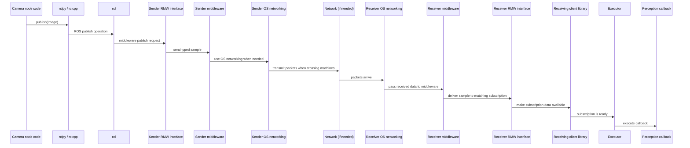

# Chapter 2 — ROS 2 Architecture

## What this chapter explains

When a ROS 2 node publishes data, several layers work together. Your Python code does not open network sockets or send Ethernet signals itself. It uses a ROS client library, which passes work through ROS's common client layer and middleware boundary. A middleware implementation and the operating system handle the communication details below that.

The main goal is to understand what each layer is responsible for—and what it is **not** responsible for.

## The whole stack

```text
┌──────────────────────────────────────────────────────────┐
│ Robot application                                        │
│ Your logic: detect a cup, plan motion, control a motor   │
└───────────────────────────┬──────────────────────────────┘
                            │ ROS API calls
┌───────────────────────────▼──────────────────────────────┐
│ Client library: rclpy (Python) or rclcpp (C++)           │
│ Lets application code create nodes and ROS interfaces    │
└───────────────────────────┬──────────────────────────────┘
                            │ Common ROS client API
┌───────────────────────────▼──────────────────────────────┐
│ rcl: common ROS client library, implemented in C         │
│ Common operations used by ROS client libraries           │
└───────────────────────────┬──────────────────────────────┘
                            │ Middleware-neutral API
┌───────────────────────────▼──────────────────────────────┐
│ RMW interface                                             │
│ The boundary between ROS client code and middleware      │
└───────────────────────────┬──────────────────────────────┘
                            │ One selected implementation
┌───────────────────────────▼──────────────────────────────┐
│ Middleware implementation, often based on DDS            │
│ Discovery, data distribution, QoS, and transport         │
└───────────────────────────┬──────────────────────────────┘
                            │ OS APIs
┌───────────────────────────▼──────────────────────────────┐
│ Operating system and hardware                            │
│ CPU scheduling, memory, networking, NIC, device drivers  │
└──────────────────────────────────────────────────────────┘
```

This is a useful learning model. The implementation has details and optimizations that vary by ROS distribution, client library, middleware, and whether communication is inside one process or across a network.

## 1. Your application code: the robot's behavior

Your application contains the robot-specific work. For example, a perception node may receive an image, identify a red cup, and publish the cup's estimated position.

```text
Image arrives
    ↓
Your perception code finds a cup
    ↓
Your code creates a detection message
    ↓
Your code asks ROS to publish it
```

Your Python code is not converted into a C source file when you call a ROS function. It remains Python code executed by Python. The code calls functions provided by `rclpy`; parts of the ROS Python implementation use compiled native extensions to connect Python with lower-level ROS libraries.

### How Python and C++ enter the ROS stack

```text
Python program ──calls──> rclpy ──> rcl and lower ROS layers
C++ program    ──calls──> rclcpp ──> rcl and lower ROS layers
```

- **`rclpy`** is the ROS 2 client library API used by Python programs.
- **`rclcpp`** is the ROS 2 client library API used by C++ programs.
- `rclpy` does not translate the whole Python program into C. It provides Python methods that connect to the native ROS implementation where needed.
- `rclcpp` does not translate C++ into C either. A C++ program is compiled into native machine instructions and uses the ROS C++ client library.

Both client libraries expose ROS concepts such as nodes, publishers, subscriptions, timers, and parameters. A Python node and a C++ node can communicate because they use compatible ROS interfaces and message definitions, not because one language is converted into the other.

The [ROS 2 middleware interface design](https://design.ros2.org/articles/ros_middleware_interface.html) explains why ROS separates its client-library API from particular middleware implementations.

## 2. What does `rcl` mean by “common client library core”?

`rcl` is a common C library used by ROS client libraries. It provides common ROS client functionality so client libraries do not each need to independently implement every lower-level operation.

Think of it like a shared service counter in a building:

```text
Python team ── rclpy ──┐
                       ├── shared ROS counter: rcl ── rest of ROS
C++ team ──── rclcpp ──┘
```

The analogy is about sharing common infrastructure. `rcl` is not a server process that receives every ROS message. It is a library used by the ROS software in your process.

### Who chooses a node's name?

You provide the node name in your application code. For example, in Python you may construct a node using the name `camera_node`. The client library passes the requested name into the lower ROS layers as it initializes the node.

The name helps identify the node in the ROS graph and is part of its ROS identity. It does not work like a guaranteed unique IP address. Multiple nodes can be given the same name; that can make command-line output and system operation confusing, so robot systems should normally use clear, unique names or namespaces.

### What is the clock for?

ROS provides clock and time abstractions so code can work with system time or ROS time. ROS time is useful in simulation and when recorded data is played back. Messages such as sensor readings often include timestamps so other components can reason about when a measurement was taken.

Important distinction: a ROS clock abstraction does **not** automatically synchronize the physical clocks on multiple computers. Distributed systems still need an appropriate clock synchronization setup if they depend on comparing timestamps across machines.

## 3. Publisher, subscriber, topic, and node are different things

These terms are easy to mix up:

| Term | What it is |
|---|---|
| Node | A logical ROS participant that owns ROS interfaces and application behavior. |
| Publisher | A ROS object inside a node that sends messages of a particular type on a topic. |
| Subscription | A ROS object inside a node that asks to receive messages of a particular type from a topic. |
| Topic | A named communication channel in the ROS graph. It is not a central storage server. |
| Message | A typed data structure, such as an image, velocity command, or detected object. |

One node can contain several publishers and subscriptions. For example, a perception node can subscribe to camera images and publish detected objects. A publisher is not itself a node, just as a method or object inside an application is not the whole application.

```text
Camera node                         Perception node
┌─────────────────────┐             ┌────────────────────────┐
│ Publisher           │             │ Subscription           │
│ Image message       │             │ receives Image         │
└──────────┬──────────┘             └────────────▲───────────┘
           │                                      │
           └──── topic name: /camera/image ──────┘
```

The topic is the shared name and type contract. It is not a Kafka-style broker that necessarily stores every message. ROS 2 middleware distributes samples to matching subscriptions according to the communication and Quality of Service (QoS) settings.

### Are there queues or buffers?

There can be buffers at different points: in the client library, middleware, operating system, or application. ROS QoS history settings affect how samples are retained for delivery. There is not necessarily one simple, fixed-size “mailbox per node” or one identical buffer per publisher. The exact buffering behavior depends on the implementation, QoS, message, and communication path.

If no subscription is currently matched, a normal volatile topic publisher generally does not keep an unlimited history for a future subscriber. Durability QoS can change whether previously published samples are retained for late-joining subscribers. We will study these details in the Topics and QoS chapters.

## 4. `rmw`: an interface and an implementation

The letters are similar, but these two terms are different:

- **RMW interface**: the middleware-neutral API boundary used by the ROS client stack.
- **RMW implementation**: a particular software package that implements that boundary using a middleware system.

One analogy is Java's interface-and-provider pattern:

```text
Application uses an interface
          ↓
An implementation supplies the behavior
```

The analogy is limited: RMW is a ROS C interface, not a Java interface, and the middleware implementations do much more than a simple network adapter. The point is that ROS application code can use a stable ROS API while an implementation handles middleware-specific details.

ROS commonly uses DDS-based implementations. The selected middleware can provide distributed discovery, data distribution, QoS behavior, and network transport. ROS also documents non-DDS middleware options, so “ROS 2 always means DDS” is too strong. The actual choice depends on what is installed and how the environment is configured. See [About different ROS 2 middleware vendors](https://docs.ros.org/en/ros2_documentation/kilted/Concepts/Intermediate/About-Different-Middleware-Vendors.html).

The division of responsibility is approximately:

```text
rclpy / rclcpp  → language-facing ROS API
rcl             → common ROS client functions
RMW interface   → middleware boundary
RMW implementation / middleware
                → discovery, data distribution, QoS, and transport
```

It is misleading to say that RMW “only moves bytes across the network.” The RMW layer is the boundary; the selected middleware implementation handles the middleware-specific work. That work can include discovery, matching compatible publishers and subscriptions, data representation, QoS, and transport.

## 5. What happens to one published message?

Suppose a camera node publishes an image and a perception node subscribes to that image.



This diagram is conceptual. The real route depends on the middleware and deployment. Two nodes in one process may use an intra-process path; communication between processes or machines may use middleware transport. ROS 2 documents both [intra-process communication](https://design.ros2.org/articles/intraprocess_communications.html) and [node composition in one process](https://docs.ros.org/en/jazzy/p/composition/index.html).

Notice the final step: the message becoming available does not mean the Python callback executes at that exact instant. The executor schedules callbacks. Executor behavior and threads belong to Chapter 4.

## 6. Nodes, processes, threads, and executors

Keep these four ideas separate:

| Concept | Meaning |
|---|---|
| Node | A logical ROS participant. |
| Process | An operating-system program instance with its own address space. |
| Thread | A path of execution inside a process. |
| Executor | ROS machinery that waits for ready work and runs callbacks. |

A node does not automatically create one process or one thread. Multiple nodes can be composed into one process. A process can use one or more threads, depending on how it is built and configured. An executor uses its available thread or threads to run callbacks.

This matters for performance: putting nodes in separate processes can improve fault isolation, while composing nodes can reduce some communication overhead. The right choice depends on reliability, resource use, and timing requirements.

## 7. Sockets, protocols, and the operating system

The extra networking questions are useful because they connect the ROS layers to familiar computer networking. The main adjustment is to treat the “bucket and valve” picture as an analogy, not as a literal description of a socket.

### What is a socket?

A socket is an operating-system communication endpoint exposed through a programming interface. On Linux, a program commonly works with a socket through a file-descriptor-like handle. The OS maintains the socket's state and usually manages send and receive buffers in kernel memory.

So:

- The socket is **not just a block of RAM**.
- It is **not usually a pair of buckets that forms a permanent private pipe to one other program**.
- The bucket picture helps visualize data waiting to be sent or received.
- The “valve” picture helps visualize that software controls when it reads, writes, or closes the endpoint.

They are two different views of the same OS communication facility: the buffers describe where data may wait; the socket API and OS state describe how a program uses the endpoint.

On Linux, `bind()` assigns a local address to a socket. For an Internet socket, that commonly means a local IP address and port, along with the socket's address family and protocol. Binding does not physically bolt a RAM bucket onto a network card. It tells the OS which local address should be associated with that socket. The [Linux `bind(2)` manual](https://man7.org/linux/man-pages/man2/bind.2.html) describes this operation.

### What is a protocol?

A protocol is a set of rules for communicating. IP, TCP, and UDP have different roles and guarantees. TCP provides an ordered byte stream with retransmission mechanisms; UDP sends individual datagrams without TCP's built-in delivery and ordering guarantees. Neither simple “TCP is reliable, UDP is fast” slogan is a complete performance comparison.

The ROS application normally works with ROS messages and QoS, not by choosing a raw TCP or UDP socket for every publisher. A DDS-based implementation may use RTPS over a network, and the exact transport path depends on the middleware and configuration. For communication inside one process, data may be passed through memory without a network socket at all.

### Does ROS create one socket per node?

Do not assume so. A ROS node is a logical participant, not an OS socket. The RMW implementation and its middleware may create and manage networking resources at a scope that differs from one node. Nodes in one process may share process-level resources; local communication may use in-process memory or shared memory; remote communication may use OS networking APIs. The exact number and arrangement of sockets is implementation-specific.

The corrected high-level responsibility is:

```text
rclpy / rclcpp and rcl
    → request ROS communication entities

RMW interface
    → provides the boundary to middleware operations

RMW implementation and middleware
    → manage discovery and communication; may use OS sockets

Operating system network stack
    → moves network packets through the network interface

Network hardware and driver
    → send/receive signals and provide hardware-specific support
```

It is too strong to say “RMW creates one socket for each node, then the OS transports everything.” The middleware and OS cooperate, and there may be no network socket for a local in-process delivery.

## 8. A Raspberry Pi and laptop example

Imagine a camera node on a Raspberry Pi and a perception node on a laptop:

```text
Raspberry Pi                                      Laptop
┌────────────────────────┐                       ┌────────────────────────┐
│ Camera node             │                       │ Perception node        │
│ publishes Image         │                       │ subscribes to Image    │
└────────────┬───────────┘                       └───────────▲────────────┘
             │                                                │
             ▼                                                │
┌────────────────────────┐   Wi-Fi / Ethernet    ┌───────────┴────────────┐
│ ROS middleware          │ ────────────────────> │ ROS middleware          │
│ and OS network stack    │                       │ and OS network stack    │
└────────────────────────┘                       └────────────────────────┘
```

At a high level, the middleware discovers compatible ROS endpoints and distributes samples. If the path crosses machines, middleware uses the operating systems' networking facilities. The OS network stack, network interface, driver, and physical network carry the packets. On the receiving machine, the middleware turns received data into a sample available to the receiving subscription, and the executor later runs its callback.

The system is distributed, but “peer-to-peer” should be used carefully. ROS 2 does not require one central ROS master to relay every normal message. However, the exact data path is middleware-dependent, and not every ROS endpoint corresponds to one dedicated point-to-point socket.

### The YouTube bucket analogy

For a client and a video service to exchange data, each side has OS-managed communication state and buffers. But it is better not to claim that there are exactly four buckets or exactly one socket per side. A browser may use multiple connections or streams, and modern video delivery can use different transport arrangements. The lesson for ROS is simply: both machines have software and OS resources involved; the exact count and layout depends on the implementation.

## 9. What device drivers do in this picture

A device driver is software that lets the operating system work with a particular hardware device. It handles hardware-specific details so higher-level software can use a more standard OS interface.

For network traffic, middleware does not directly turn Python data into radio waves. The middleware asks the operating system to send data. The OS network stack passes data to the network interface driver, and the driver works with the network hardware. The receiving side follows the reverse path.

```text
ROS middleware
    ↓ OS networking API
OS network stack
    ↓ device-specific driver
Sending network interface hardware
    ↓ Wi-Fi / Ethernet network
Receiving network interface hardware
    ↓ device-specific driver
OS network stack
    ↓
ROS middleware
```

Drivers can run in different privilege models depending on the device and operating system. For this chapter, the important idea is that the driver connects the OS to hardware; a ROS node does not normally operate a network card by directly controlling its electrical signals.

## 10. What the layered architecture does—and does not—promise

The layers help separate robot logic from communication implementation. They do not automatically guarantee:

- zero-copy delivery;
- one socket per node;
- one thread per node;
- a globally synchronized clock;
- that every published message is stored until a subscriber appears;
- zero latency or real-time behavior;
- that a selected middleware works the same way on every network.

Latency can come from application computation, message conversion, copies, middleware scheduling, queues, operating-system scheduling, network congestion, or hardware. ROS 2 has options to improve behavior for particular needs, but the full system must be designed and measured. ROS's [real-time design proposal](https://design.ros2.org/articles/realtime_proposal.html) discusses why real-time properties depend on the middleware and the rest of the system, not on ROS architecture alone.

## 11. Spring Data JPA analogy: useful but limited

Your Spring Data JPA comparison helps with one point: application code uses an API while framework layers provide reusable implementation and infrastructure behind it.

```text
Java application → Spring Data API → provider / database driver → database
ROS application  → rclpy/rclcpp → rcl → RMW / middleware → OS and network
```

The analogy stops there. ROS middleware is not a database; a topic is not a database table; and `rclpy` is not translating robot logic into C. ROS layers coordinate communication entities and data flow, while a database framework manages persistence and queries.

## A compact way to remember the roles

```text
Application:       What should the robot do?
rclpy / rclcpp:    How does my language express ROS operations?
rcl:               What common ROS client functionality is needed?
RMW interface:     What is the middleware boundary?
Middleware:        How are endpoints discovered and samples distributed?
Operating system:  How are CPU, memory, and network resources managed?
Driver/hardware:   How does the OS interact with the physical device?
```

For one image message, remember:

```text
Camera code creates an Image message
    ↓
The ROS client stack passes a publish request downward
    ↓
Middleware matches and distributes the sample
    ↓
The OS/network is involved if the selected path crosses processes or machines
    ↓
The receiving subscription becomes ready
    ↓
An executor runs the perception callback
```

## Key points

1. `rclpy` and `rclcpp` are ROS client libraries; they do not translate the whole application into C.
2. `rcl` is a shared C client-library layer used by ROS client libraries.
3. RMW is an interface boundary; an RMW implementation connects that boundary to middleware.
4. DDS is a common ROS 2 middleware family, but it is not the ROS API and is not the only possible middleware approach.
5. A publisher or subscription belongs to a node; a topic is the named, typed communication channel.
6. Nodes, processes, threads, executors, buffers, and sockets are separate concepts.
7. A socket is an OS communication endpoint, not just a memory bucket; `bind()` associates a local address with it.
8. Middleware and the OS cooperate to communicate. The OS network stack and hardware carry packets when the chosen path uses a network.
9. ROS 2 does not require a central master to relay all messages, but “peer-to-peer” does not mean one dedicated socket per node pair.
10. Architecture helps organize a system; latency, reliability, and real-time behavior still require design and measurement.

## Official references

- [ROS 2 middleware interface design](https://design.ros2.org/articles/ros_middleware_interface.html)
- [Different ROS 2 middleware vendors](https://docs.ros.org/en/ros2_documentation/kilted/Concepts/Intermediate/About-Different-Middleware-Vendors.html)
- [Intra-process communication design](https://design.ros2.org/articles/intraprocess_communications.html)
- [ROS 2 composition examples](https://docs.ros.org/en/jazzy/p/composition/index.html)
- [Linux `bind(2)` manual](https://man7.org/linux/man-pages/man2/bind.2.html)
- [Linux `socket(7)` manual](https://www.man7.org/linux/man-pages/man7/socket.7.html)
- [ROS 2 real-time design proposal](https://design.ros2.org/articles/realtime_proposal.html)

