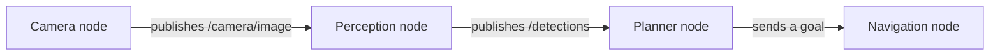
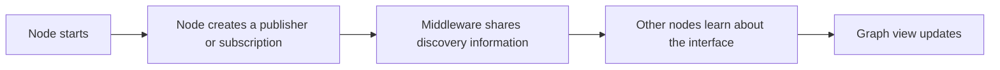
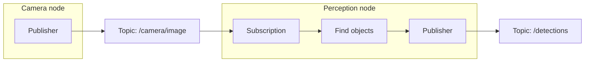
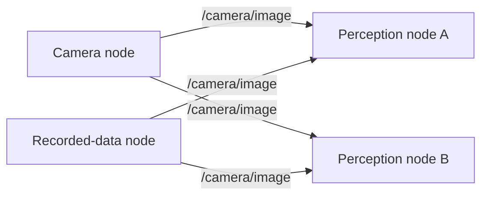
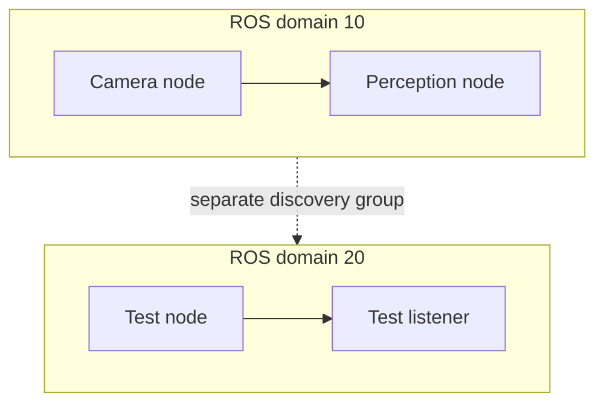
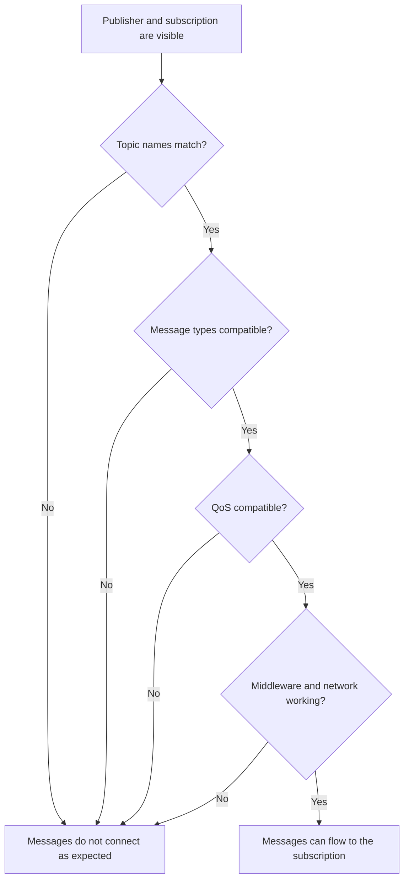
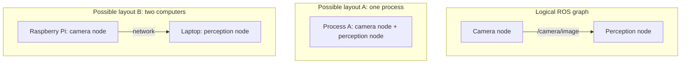
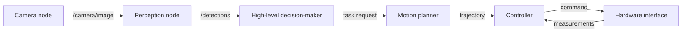

# Chapter 3 — The ROS Graph

## What is the ROS graph?

The ROS graph is a **live map of the ROS parts that have been discovered**. It shows nodes and the communication interfaces they use, such as topics, services, and actions.

Think of it as a transit map. The map shows stations and routes. It does not show every detail of the train tracks or how the train is powered.

In a ROS graph:

- A **node** is a ROS participant.
- A **topic, service, or action** shows how nodes can communicate.



This diagram shows the **logical connections** between ROS components. It does not show which computer or process runs each node.

## Why have a graph?

The graph helps us inspect a ROS system while it is running. It can help answer questions such as:

- Is the camera node running?
- Did the perception node create its image subscription?
- What topic name is being used?
- Are the expected service or action endpoints visible?

ROS tools can show parts of this information. We will use those tools in the ROS command-line chapter.

## How do nodes become visible to each other?

When a node starts, it creates ROS interfaces such as publishers and subscriptions. ROS middleware helps participants discover those interfaces. The graph view is then updated as discovery information becomes available.

ROS 2 does not require one central ROS master to keep the graph and relay every normal message. In common DDS-based setups, discovery is distributed across the participants. The exact details depend on the middleware and its configuration. [ROS 2's middleware design](https://design.ros2.org/articles/ros_on_dds.html) describes distributed discovery, and the [middleware documentation](https://docs.ros.org/en/ros2_documentation/kilted/Concepts/Intermediate/About-Different-Middleware-Vendors.html) describes the supported middleware choices.

The graph can change while the system runs:



Discovery is not always instant. For a short time, different parts of a system may have slightly different views while updates are still arriving.

## Nodes and communication interfaces

A node can use one or many communication interfaces. For example, a perception node can receive camera images and publish detected objects.



The main communication patterns are:

| Pattern | What it is used for |
|---|---|
| Topic | A stream of messages, such as images or robot position. |
| Service | A request followed by a response, often for a short task. |
| Action | A longer task that can provide progress and may be cancelled. |

Topics, services, and actions are ROS concepts. The middleware implements their communication underneath.

## A topic is not a storage server

A topic is a **name and communication path** shared by publishers and subscriptions. It is not a central box that saves every message, like a permanent message log.

There may be several publishers and several subscriptions using one topic:



The middleware distributes messages to compatible subscriptions. The message type and Quality of Service settings also matter. We will study topic details and QoS in later chapters.

## Names and namespaces

Names help us tell parts of a ROS system apart. A **namespace** groups node and topic names. This is useful when a system has multiple robots or multiple copies of the same component.

For example:

```text
/robot1/camera
/robot2/camera
```

Both nodes can use the short name `camera`, but their full names are different because they are in different namespaces.

Topic names can be grouped in the same way:

```text
/robot1/camera/image
/robot2/camera/image
```

A relative name uses the node's namespace. An absolute name starts with `/` and is already rooted.

```text
Node namespace: /robot1

Relative topic: image       becomes /robot1/image
Absolute topic: /image      stays /image
```

Namespaces organize ROS names. They are not IP addresses or network ports. The official [ROS name design](https://design.ros2.org/articles/topic_and_service_names.html) explains how relative and fully qualified names work.

## Domain IDs

For DDS-based middleware, a **domain ID** separates groups of ROS participants. Participants using different domain IDs normally do not discover each other.



This is useful when separate ROS systems share a network. A domain ID is not the same as a namespace:

- A **namespace** groups names inside a ROS graph.
- A **domain ID** separates DDS discovery groups.

A domain ID is not a security feature. Network settings, middleware choices, and security settings still matter.

## Seeing an endpoint does not prove that data is working

The graph can show that a publisher and subscription exist. That does not prove every message is reaching the application correctly.

For topic communication to work, the publisher and subscription need compatible settings. For example, they need to use the same topic name and compatible message types and QoS settings. The network and middleware must also allow communication.



So keep these questions separate:

- **Graph question:** Can I see the expected nodes and interfaces?
- **Communication question:** Is the data actually arriving?
- **Application question:** Is the receiving code processing useful data?

## The logical graph is not the computer layout

The ROS graph shows logical nodes and connections. It does not show whether nodes run in one process, several processes, or on several computers.



The same logical graph can have different physical layouts. If nodes run in one process, communication may use an in-process path. If they run on different computers, communication may use the network. Chapter 4 will explain processes, threads, executors, and callbacks in more detail.

## Example: the red-cup robot

Here is one possible logical graph for a robot that finds a red cup and moves near it:



The last two connections form a **feedback loop**. The controller sends commands and receives measurements about what the robot actually did.

This graph shows the flow of information. It does not decide which component should run on which computer or how quickly each component must run.

## What the ROS graph is—and is not

The ROS graph **is**:

- a view of discovered ROS nodes and interfaces;
- useful for understanding the connections in a running robot system;
- able to change as nodes start, stop, or create interfaces.

The ROS graph **is not**:

- a central server that must relay every message;
- a picture of every process, thread, IP address, or physical cable;
- proof that messages are arriving or that application code is correct.

## Key points

1. The ROS graph is a live map of discovered nodes and communication interfaces.
2. Nodes are participants; topics, services, and actions describe ways they communicate.
3. ROS 2 does not require one central ROS master for normal discovery.
4. Namespaces organize names. Domain IDs separate DDS discovery groups.
5. The graph shows logical connections, not the full computer and network layout.
6. Seeing an endpoint does not guarantee that messages are flowing correctly.

## Official references

- [ROS 2 middleware design and discovery](https://design.ros2.org/articles/ros_on_dds.html)
- [Different ROS 2 middleware vendors](https://docs.ros.org/en/ros2_documentation/kilted/Concepts/Intermediate/About-Different-Middleware-Vendors.html)
- [ROS 2 topic and service names](https://design.ros2.org/articles/topic_and_service_names.html)
- [ROS graph topic names and types API](https://docs.ros.org/en/kilted/p/rmw/generated/function_get__topic__names__and__types_8h_1a2186a91a382110bdab089f8e4d4d732a.html)

