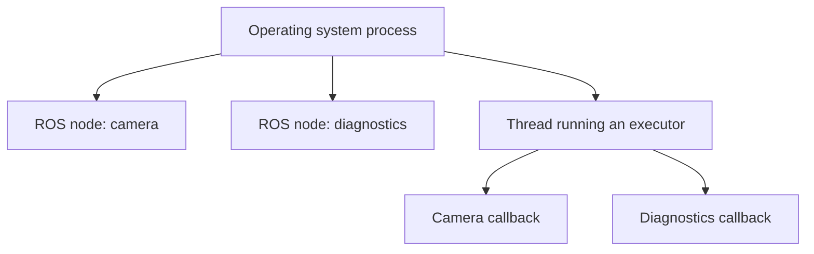
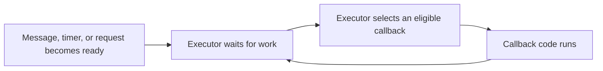
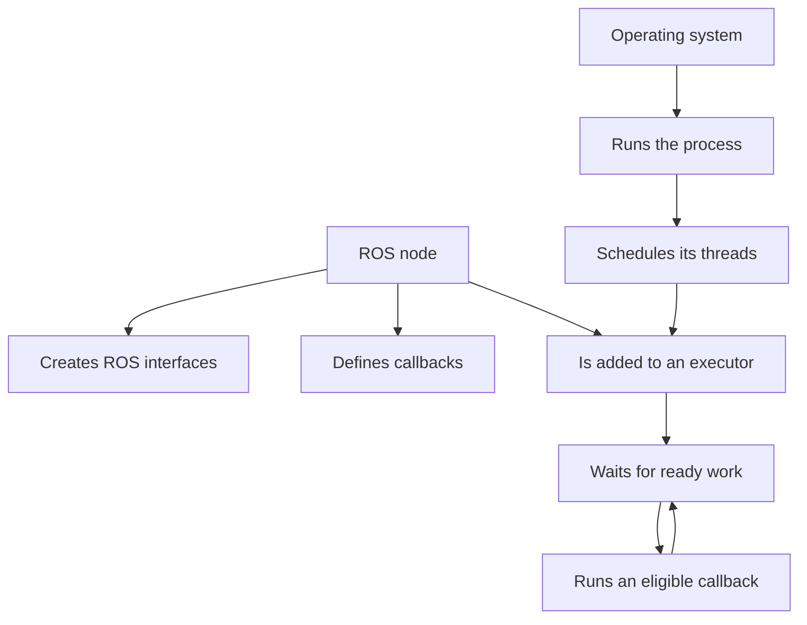

# Chapter 4 — Nodes and Execution

This chapter explains how ROS 2 runs the code inside a node. We’ll distinguish nodes, processes, and threads, then see how callbacks, executors, and callback groups work together.

## What you will learn

- What a ROS node is—and what it is not
- What callbacks do
- How an executor runs callbacks
- How single-threaded and multi-threaded execution differ
- How callback groups control concurrency
- Why execution choices matter for latency and robot behavior

## 1. Node, process, and thread

These terms describe different things:

| Term | Meaning |
|---|---|
| **Node** | A participant in the ROS graph. It can create publishers, subscribers, services, actions, and parameters. |
| **Process** | A running program managed by the operating system. It has its own memory and resources. |
| **Thread** | A path of execution inside a process. Threads in the same process share its memory. |

A node is not automatically a process or a thread. A process can contain one node or several nodes. A node’s callbacks may run on one thread or, depending on the executor, on multiple threads.



Nodes can also run in separate processes. Keeping nodes in separate processes can isolate failures and let components run independently. Putting several nodes in one process can reduce some communication overhead. The ROS graph describes nodes and their connections; it does not require one process layout.

### Java comparison

A node is like a named ROS component with defined communication interfaces. It may be implemented using one or more Python classes, but it is not the same thing as a Java service or a running Java application.

A process is closer to a running Java application. A thread is a worker inside that application.

## 2. Callbacks: functions that handle events

A **callback** is a function that ROS runs when an event is ready to handle.

| Event | Callback job |
|---|---|
| A message arrives | Read and process the message |
| A timer becomes ready | Perform periodic work |
| A service request arrives | Calculate and return a response |
| An action goal arrives | Start or manage a longer task |

For example, a camera-processing node may subscribe to an image topic. Its subscription callback handles each image message.

```text
Image message arrives
        ↓
Subscription callback becomes ready
        ↓
Executor runs the callback
        ↓
Callback processes the image
```

Receiving a message makes work ready. It does not mean your callback runs immediately at that exact moment. The executor runs it when it can.

## 3. Executors: the code that runs callbacks

An **executor** waits for ROS work to become ready and runs the callbacks for its nodes. It connects events—such as messages, timers, and requests—to your callback code.



In `rclpy`, `rclpy.spin(node)` is a convenient way to keep an executor working on a node. “Spin” does not mean “create a separate thread for this node.” It means, roughly, “keep waiting for and running callbacks until shutdown.”

## 4. Single-threaded and multi-threaded execution

### Single-threaded executor

A single-threaded executor runs callbacks one at a time on its executor thread:

```text
Callback A starts → Callback A finishes → Callback B starts
```

This is straightforward to reason about. But if Callback A takes a long time, other callbacks handled by that executor may have to wait.

For example, if image processing occupies the executor for 400 milliseconds, a timer callback that becomes ready during that time cannot run until the executor is available.

### Multi-threaded executor

A multi-threaded executor has a pool of threads available to run callbacks. It can allow eligible callbacks to overlap in time:

```text
Thread 1: Callback A ─────────
Thread 2:       Callback B ──
```

This does not mean every callback automatically runs at the same time. The executor follows callback-group rules, and the operating system schedules the threads.

Python also has a Global Interpreter Lock, or **GIL**, in standard CPython. It limits how much CPU-heavy Python code can run in parallel across threads. Threads can still be useful for work that waits on input/output, and some native libraries can release the GIL while doing their work. A multi-threaded executor alone does not guarantee faster processing.

## 5. Callback groups: rules for callbacks

A **callback group** controls which callbacks in a node are allowed to run at the same time. A callback group is a set of rules; it is not itself a thread.

ROS 2 provides two common types:

- **Mutually exclusive:** callbacks in the group do not run simultaneously.
- **Reentrant:** callbacks in the group are allowed to overlap, including two invocations of the same callback.

Each node’s default callback group is mutually exclusive. So choosing a multi-threaded executor does not automatically make all callbacks in that node concurrent. Callbacks in the default group are still restricted to running one at a time.

To allow callbacks in different groups to overlap, the node needs a multi-threaded executor and a callback-group setup that permits it.

### Why control callback overlap?

Callbacks may read and change the same data. If they change shared state at the same time, the result may be inconsistent. Callback groups help control when callbacks can overlap, but the programmer still needs to think carefully about shared data.

## 6. Long callbacks and latency

Imagine one node has both a camera callback and a safety callback:

```text
Camera callback: processes a large image and takes a long time
Safety callback: checks whether the robot must stop
```

With a single-threaded executor, the camera callback may keep the executor busy while the safety callback waits. That delay could matter to the robot.

Design choices that can help include:

- Keep callbacks short.
- Move lengthy work out of time-sensitive callbacks.
- Use more than one executor thread when appropriate.
- Choose callback groups that allow the required overlap.
- Separate responsibilities into different nodes or processes.
- Measure the system’s timing under realistic conditions.

These choices can help manage delay, but they do not guarantee zero latency or real-time behavior. The operating system, CPU load, network, middleware, callback workload, and hardware can all affect timing.

## 7. A node’s lifetime

An ordinary node is created by an application, uses ROS communication interfaces, and is eventually shut down. Its callbacks run while an executor is servicing it.

ROS 2 also supports **managed lifecycle nodes**. These have explicit states, such as configuring and activating, so a system can control when a component is ready to operate. This is useful in larger systems and with hardware. It is a separate ROS feature; it does not mean every ordinary node automatically uses those states.

## A complete mental model



- A **node** describes a participant in the ROS graph.
- A **callback** is your function for handling an event.
- An **executor** runs callbacks when they are ready and allowed to run.
- A **process** and its **threads** are managed by the operating system.
- A **callback group** controls which callbacks may overlap.

## Common misunderstandings

| Misunderstanding | Better mental model |
|---|---|
| One node always equals one process. | A process can contain one node or several nodes. |
| One node always equals one thread. | A node’s callbacks run through an executor, which may use one or more threads. |
| A timer creates a thread. | A timer makes a callback ready to run. |
| A multi-threaded executor runs every callback in parallel. | Callback-group rules determine which callbacks may overlap. |
| Multi-threading guarantees low latency. | It can help with execution, but timing depends on the whole system. |

## Connection to robot systems

A robot may have camera, perception, planning, and control nodes. Each node can define callbacks for the data or events it handles. The executor determines when those callbacks run.

Execution design matters when one callback’s work can delay another callback—for example, when slow image processing could delay a safety check or a controller update. Understanding nodes and executors helps us reason about where delays can happen and how to design the system around them.

## Official ROS 2 references

- [Executors](https://docs.ros.org/en/rolling/Concepts/Intermediate/About-Executors.html)
- [Using callback groups](https://docs.ros.org/en/rolling/How-To-Guides/Using-callback-groups.html)
- [`rclpy` executor API](https://docs.ros.org/en/rolling/p/rclpy/rclpy.executors.html)
- [ROS 2 composition](https://docs.ros.org/en/jazzy/p/composition/index.html)
