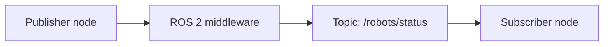
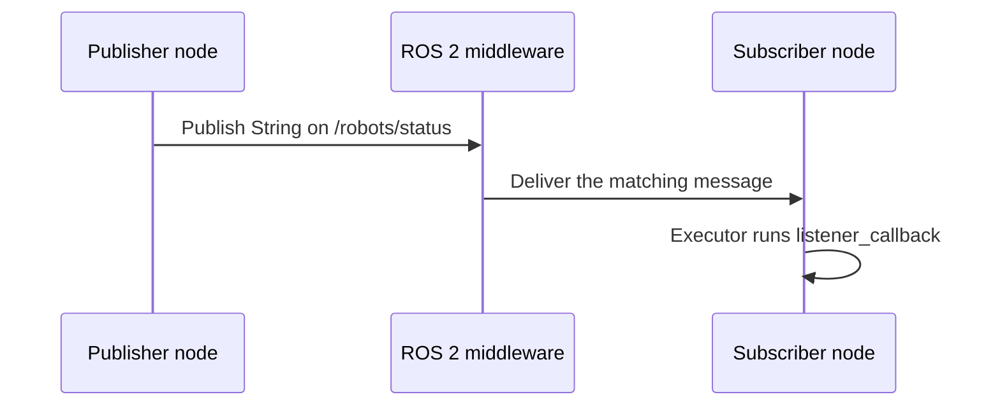

# Chapter 5 — Topics and Messages

This chapter explains how ROS 2 nodes exchange data using **topics** and **messages**. We built a status publisher and subscriber, ran them as separate programs, and inspected their communication.

## What you will learn

- What topics and messages are
- How publishers and subscribers connect
- How a subscription callback receives data
- What the QoS queue depth controls
- What ROS 2 showed when we inspected the topic

## 1. Topics connect nodes

A **topic** is a named channel for communication. A publisher sends messages to the topic. Subscribers that listen to the same topic can receive them.



The publisher does not call a function on the subscriber. It publishes data to a topic, and the subscriber handles that data when it arrives.

This keeps the nodes independent:

- The publisher does not need to know which nodes are listening.
- A subscriber can be added without changing the publisher.
- Several subscribers can listen to the same topic.
- Several publishers can publish to one topic, provided their messages have compatible types and meanings.

Topics are commonly used for data streams such as sensor readings, camera images, robot positions, and status updates. Communication is asynchronous: publishers send data, and subscribers process it in their own callbacks.

## 2. Messages have a type

A **message** is typed data sent through a topic. The message type defines its fields.

Our example uses `std_msgs/msg/String`, which has a `data` field containing text:

```text
Message type: std_msgs/msg/String
Field:        data
Value:        "Searching for a red cup"
```

A topic name and message type are different parts of the communication contract:

```text
Topic name:   /robots/status
Message type: std_msgs/msg/String
```

The publisher and subscriber must use the same topic name and compatible message types. ROS interfaces define the data structure so that different nodes can agree on what a message contains. [ROS 2 interfaces](https://docs.ros.org/en/rolling/Concepts/Basic/About-Interfaces.html)

## 3. Publisher: send a message

A publisher is created by a node. It has a message type and a topic name.

```python
self.publisher_ = self.create_publisher(
    String,
    "/robots/status",
    10,
)
```

The arguments are:

- `String`: the message type
- `"/robots/status"`: the topic name
- `10`: a shorthand for the QoS queue depth

To publish, the timer callback creates a message, assigns its `data` field, and calls the publisher:

```python
msg = String()
msg.data = "Searching for a red cup"
self.publisher_.publish(msg)
```

The publisher sends the message to ROS 2 middleware. It does not wait for the subscriber’s callback to finish.

## 4. Subscriber: receive a message

A subscription tells a node which topic and message type to receive, and which callback to run for each received message.

```python
self.subscriber_ = self.create_subscription(
    String,
    "/robots/status",
    self.listener_callback,
    10,
)
```

The callback receives a message object. In our example, its text is available through `msg.data`:

```python
def listener_callback(self, msg):
    self.get_logger().info(f'I heard: "{msg.data}"')
```

The executor must be running for the callback to be handled, just as it was for timer callbacks in Chapter 4.



ROS 2 uses a middleware layer—commonly backed by DDS implementations—to discover endpoints and transport messages. The topic and message type describe the communication; ROS 2 handles discovery and delivery.

## 5. QoS and queue depth

**Quality of Service (QoS)** settings define how ROS 2 endpoints handle communication. In our code, we passed the integer `10`. That specifies a history depth of 10 using the default QoS profile.

Our topic inspection showed:

| QoS setting | Observed value | Meaning |
|---|---|---|
| Reliability | `RELIABLE` | The middleware uses reliable delivery behavior. |
| History | `KEEP_LAST` | Keep recent messages according to the configured depth. |
| Depth | `10` | Retain up to 10 samples in the endpoint’s history. |
| Durability | `VOLATILE` | A late subscriber does not receive old messages published before it joined. |

Queue depth is a temporary buffer, not a permanent recording. If messages arrive faster than a subscriber can process them, the history settings affect which messages remain available. In this exercise, the subscriber handled one message per second quickly, so the queue did not visibly fill.

For a late subscriber to receive a publisher’s recent messages while that publisher is still running, compatible endpoints can use **Transient Local** durability. For recording and playback after the publisher stops, ROS 2 provides bags. We will study QoS more deeply later. [ROS 2 QoS settings](https://docs.ros.org/en/rolling/Concepts/Intermediate/About-Quality-of-Service-Settings.html)

## 6. Our build

We created two separate programs:

```text
01_status_publisher.py
02_status_subscriber.py
```

The publisher sends `"Searching for a red cup"` about once per second on `/robots/status`. The subscriber listens to that topic and logs the text it receives.

We ran each program in a separate terminal using the project’s Pixi environment:

```bash
pixi run python 02_status_subscriber.py
pixi run python 01_status_publisher.py
```

The subscriber displayed each new message. Running the programs separately showed that the nodes can communicate without sharing a Python process or directly calling each other.

## 7. Inspecting the ROS graph

With both nodes running, we listed topics:

```bash
pixi run ros2 topic list
```

The output included:

```text
/parameter_events
/robots/status
/rosout
```

We then inspected the topic:

```bash
pixi run ros2 topic info /robots/status --verbose
```

ROS reported:

```text
Type: std_msgs/msg/String
Publisher count: 1
Subscription count: 1
```

The output also showed a publisher endpoint named `status_publisher_node` and a subscription endpoint named `status_subscriber_node`. Their matching message type hash confirmed that both endpoints used the same message definition. The QoS details showed `RELIABLE`, `KEEP_LAST (10)`, and `VOLATILE`.

## Common mistakes

| Mistake | Why it causes a problem |
|---|---|
| Publisher and subscriber use different topic names | ROS treats `/robot/status` and `/robots/status` as separate topics. |
| Publisher and subscriber use incompatible message types | The subscriber cannot interpret the publisher’s data as its requested type. |
| Assuming publishing confirms callback processing | Publishing sends data; it does not confirm that a subscriber finished handling it. |
| Treating queue depth as a replay history | Depth is part of temporary QoS history; it does not provide late-joiner replay with volatile durability. |
| Expecting a topic to store every message forever | Topics are communication channels, not permanent storage. Use a bag to record data for later playback. |

## Chapter takeaway

A topic is a named channel for typed ROS messages. Publishers send messages, and subscribers receive them through callbacks when their executors run. This lets robot components exchange streams of data while remaining modular.

Our status publisher and subscriber gave us a small working example of this communication path. We also saw how an exact topic-name match matters and how QoS describes delivery and history behavior.

## Official ROS 2 references

- [Topics](https://docs.ros.org/en/rolling/Concepts/Basic/About-Topics.html)
- [Interfaces](https://docs.ros.org/en/rolling/Concepts/Basic/About-Interfaces.html)
- [Quality of Service settings](https://docs.ros.org/en/rolling/Concepts/Intermediate/About-Quality-of-Service-Settings.html)
- [Writing a simple Python publisher and subscriber](https://docs.ros.org/en/rolling/Tutorials/Beginner-Client-Libraries/Writing-A-Simple-Py-Publisher-And-Subscriber.html)
