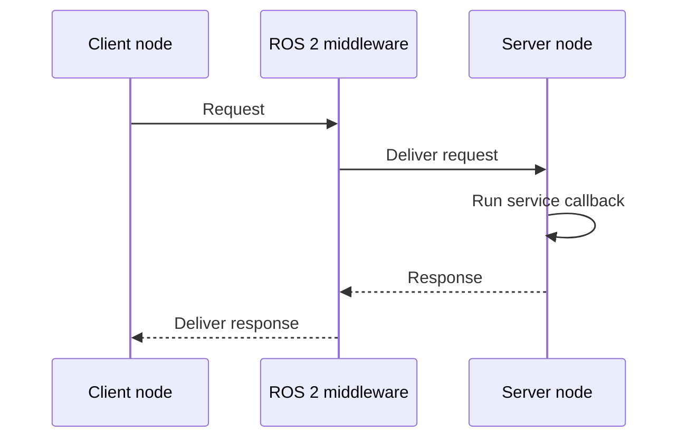
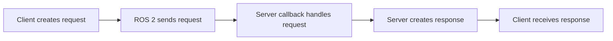

# Chapter 6 — Services

This chapter explains how ROS 2 nodes communicate using **services**. A service lets one node send a request to another node and receive a response.

## What you will learn

- What a service client and service server do
- How requests and responses are defined
- How the service callback fits into a node’s executor
- When to use a service, topic, or action
- Why blocking service calls need care

## 1. The request–response mental model

A service has two sides:

- A **service server** offers an operation and handles requests.
- A **service client** sends a request and receives the response.



The client does not directly call a Python method inside the server. It sends a request through ROS 2. The server’s executor runs a callback to handle that request.

A service is named, for example:

```text
/set_led
```

The client and server must agree on both the service name and the service type.

## 2. A service type defines both sides

A ROS service type defines the fields in its request and its response. For example, a conceptual `/set_led` service might contain:

```text
Request:
    turn_on: true

Response:
    success: true
    message: "LED is on"
```

In a ROS interface definition, the request and response are separated by `---`:

```text
bool turn_on
---
bool success
string message
```

The fields above are illustrative; this chapter does not define a custom service type. The service type is a shared contract that both client and server use. [ROS 2 interfaces](https://docs.ros.org/en/rolling/Concepts/Basic/About-Interfaces.html)

## 3. What happens during a service call?

A typical service exchange works like this:

1. The server creates the service and waits for requests.
2. The client creates a client for that service.
3. The client sends a request.
4. The server’s executor runs the service callback.
5. The callback fills in a response.
6. The client receives the response.



The client can check whether a service is available before calling it. This matters when nodes start at different times: the client may need to wait for the server to appear.

## 4. Service callbacks and executors

The service server’s callback receives a request and fills out a response. Like a subscription callback, it runs when the node’s executor handles the ready work.

```text
Request arrives
      ↓
Service callback becomes ready
      ↓
Executor runs the callback
      ↓
Callback returns a response
```

This connects to Chapter 4. If a service callback takes a long time, it can occupy an executor thread and delay other callbacks that depend on that thread.

## 5. Synchronous and asynchronous calls

A **synchronous** client call waits for the response before continuing:

```text
Send request → wait here → receive response → continue
```

An **asynchronous** call starts the request and returns a future. The client can continue doing other work and handle the response when it becomes ready:

```text
Send request → continue other work → handle response when ready
```

A synchronous wait can block the code that made the call. In a callback, that may prevent the executor from running other work. Asynchronous calls are often more suitable when a node must remain responsive.

## 6. When should we use a service?

Services are a good fit for **short request–response operations**, such as:

- “Turn the LED on.”
- “Reset this counter.”
- “Set the current operating mode.”
- “Calculate and return this value.”

A request such as “navigate to this location” may take a long time. The client may need progress updates or a way to cancel it. That is a better fit for an **action**, which we’ll study in Chapter 7.

## 7. Topics, services, and actions

| ROS communication | Shape | Good fit |
|---|---|---|
| **Topic** | Publishers send messages; subscribers receive them | Ongoing data or events |
| **Service** | Client sends one request; server returns one response | Short operation with a result |
| **Action** | Client starts a task; server can provide feedback and a result, and the task can be canceled | Longer-running work |

A service is not a replacement for every function call. Use it when a ROS node needs another node to perform a short operation and return an answer.

## 8. What a service does not guarantee

A service provides a request–response communication pattern. It does not automatically guarantee that:

- The server is available whenever the client calls.
- The operation finishes quickly.
- A client receives a response if a node or connection fails.
- A long-running task can provide progress or be canceled.

The application needs to decide how to handle unavailable servers, errors, timeouts, and retries. Actions are designed for longer tasks that need feedback or cancellation.

## Java and web-service comparison

A ROS service may feel like a method call to another service or a request to an API:

```text
Client sends request
        ↓
Server performs operation
        ↓
Client receives response
```

That comparison helps explain the request–response pattern. A ROS service is still part of the ROS graph: clients and servers use ROS service interfaces and middleware. A service server is not automatically a web server, Java microservice, or separate operating-system process.

## Chapter takeaway

A ROS 2 service is a named request–response interface between ROS nodes. The client asks for a short operation, the server handles it in a callback, and the client receives a response.

Use topics for data streams, services for short operations with responses, and actions for longer tasks that need feedback or cancellation.

## Official ROS 2 references

- [About services](https://docs.ros.org/en/rolling/Concepts/Basic/About-Services.html)
- [About interfaces](https://docs.ros.org/en/rolling/Concepts/Basic/About-Interfaces.html)
- [Writing a simple Python service and client](https://docs.ros.org/en/rolling/Tutorials/Beginner-Client-Libraries/Writing-A-Simple-Py-Service-And-Client.html)
