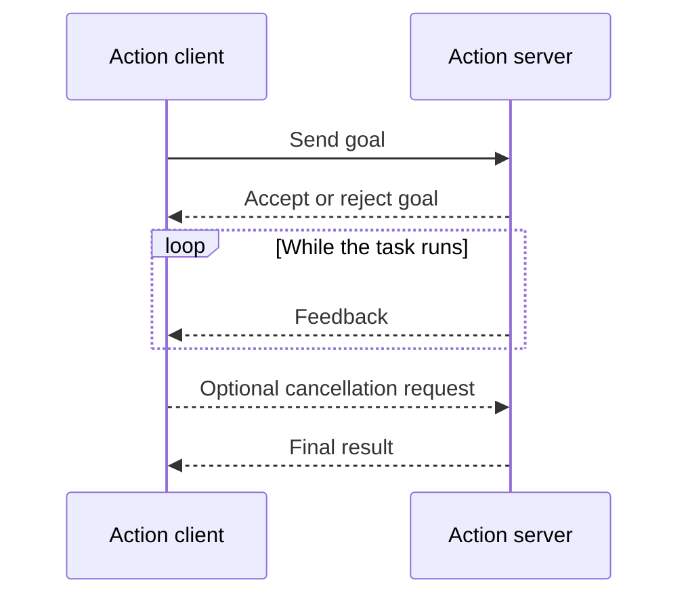
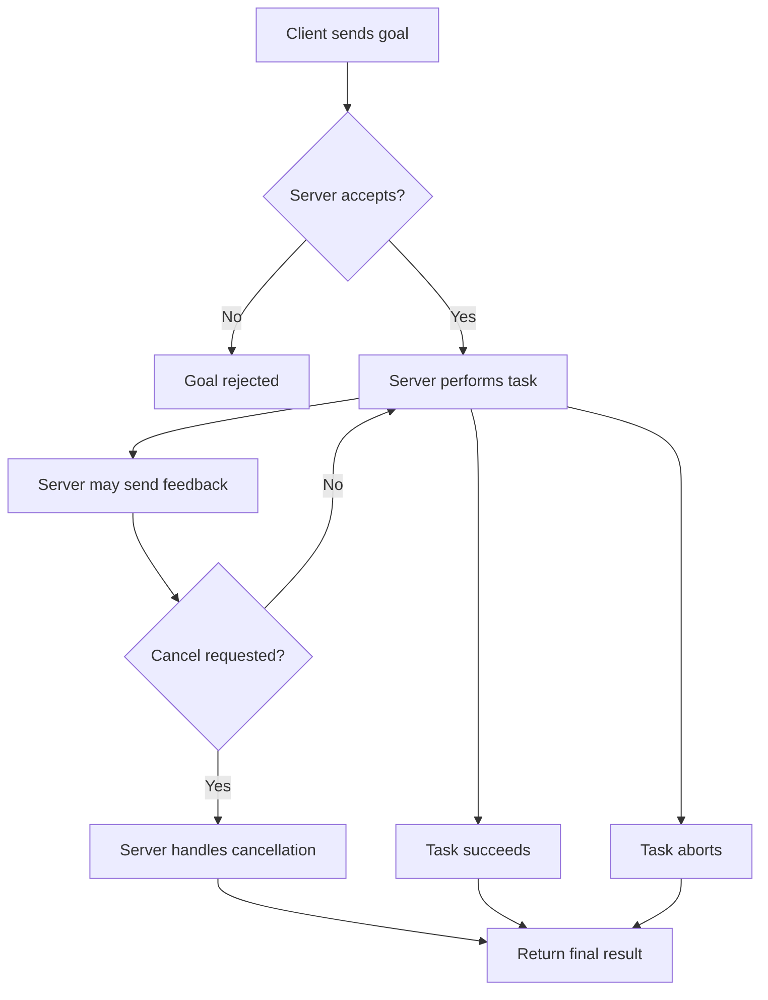

# Chapter 7 — Actions

This chapter explains how ROS 2 handles longer-running tasks. An action lets a client send a goal to a server, receive progress feedback, request cancellation, and get a final result.

## What you will learn

- What an action client and server do
- What goals, feedback, and results mean
- How an action task proceeds
- How actions differ from topics and services
- Why a cancellation request does not instantly stop a robot

## 1. The basic mental model◊

An action has two main roles:

- The **action client** requests a task by sending a goal.
- The **action server** handles the goal, sends feedback while working, and returns a result when it finishes.



For example, a navigation client may ask a robot to move to a target position. While the robot is moving, the action server can send progress updates. When the task finishes, it returns a result.

## 2. Goal, feedback, and result

An action interface defines three sections:

1. **Goal:** what the client asks the server to do.
2. **Feedback:** progress information sent while the task is running.
3. **Result:** final information returned when the task ends.

An action definition uses `---` separators between these sections. This example is illustrative:

```text
# Goal
target_distance: 5.0
---
# Result
distance_traveled: 5.0
---
# Feedback
distance_remaining: 2.0
```

The exact fields depend on the action type. The action interface is the shared contract between the client and server.

## 3. How an action task proceeds

A typical action follows these steps:

1. The client sends a goal.
2. The server accepts or rejects it.
3. If accepted, the server begins the task.
4. While working, the server may send feedback.
5. The client may request cancellation.
6. The server finishes, aborts, or accepts cancellation and stops.
7. The server returns a final result.



A cancellation request does not force an instant stop. The server decides how to handle it. A robot may need to slow down or reach a safe state before it stops.

## 4. Actions, services, and topics

| ROS communication | Communication shape | Example |
|---|---|---|
| **Topic** | Publishers send messages; subscribers receive them | Camera images or sensor readings |
| **Service** | Client sends one request and receives one response | Reset an odometry counter |
| **Action** | Client sends a goal, receives optional feedback, and gets a result | Navigate to a location |

Use a service for a short request that can return promptly. Use an action when a task takes time and the client needs progress or cancellation. Use a topic for ongoing data that is not tied to one specific request.

## 5. Actions under the hood

The action API looks like one goal, feedback stream, and result. Underneath, ROS 2 uses services and topics to manage the interaction, including goal requests, results, cancellation, and feedback.

Most application code uses ROS 2’s action client and server APIs. ROS handles the internal communication endpoints. [ROS 2 actions](https://docs.ros.org/en/rolling/Concepts/Basic/About-Actions.html)

## 6. How an action can finish

An action goal commonly finishes in one of these ways:

- **Succeeded:** the task completed successfully.
- **Aborted:** the server stopped because it could not complete the task.
- **Canceled:** the server accepted a cancellation request and stopped the task.

The final result contains the task’s result data. The outcome tells the client how the task ended.

## 7. Robotics examples

Actions are useful for tasks such as:

- Navigating to a pose
- Executing a robot-arm trajectory
- Picking up an object
- Moving an elevator or other mechanism to a target

For navigation, a goal might contain a target pose. Feedback might report progress toward that pose. The final result could report success or failure.

## Chapter takeaway

An action lets a client start and track a longer-running task. The client sends a goal; the server can accept or reject it, provide feedback, handle cancellation requests, and return a result.

This makes actions a good fit for robot tasks such as navigation and manipulation, where a client needs more information than a single immediate response.

## Official ROS 2 references

- [About actions](https://docs.ros.org/en/rolling/Concepts/Basic/About-Actions.html)
- [About interfaces](https://docs.ros.org/en/rolling/Concepts/Basic/About-Interfaces.html)
- [Writing a simple Python action server and client](https://docs.ros.org/en/rolling/Tutorials/Intermediate/Writing-an-Action-Server-Client/Py.html)
